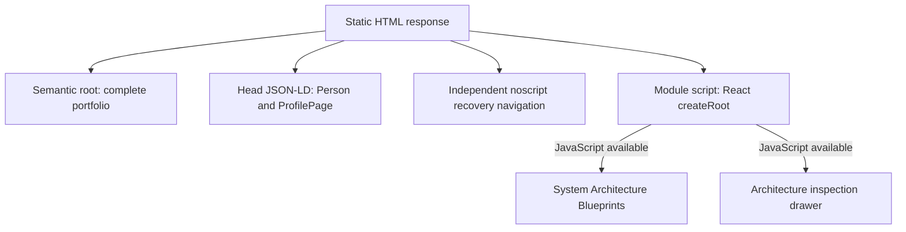

# Architecture & Evaluation Portfolio

**Djessi Jorge — Solutions Architect / Agentic AI Engineer · London, UK**

[Live portfolio](https://portfolio.djessi2.chatgpt.site/) · [LinkedIn](https://www.linkedin.com/in/djessijorge/) · [GitHub profile](https://github.com/djessijorge9-ship-it/)

The public origin is **https://portfolio.djessi2.chatgpt.site/**. Canonical metadata, Open Graph, JSON-LD and the copied executive summary use this same origin. The offline verifier checks their URL parity; public HTTP and browser checks verify deployment availability separately.

## 1. Executive Overview & Architectural Philosophy

This repository contains the portfolio application, its static crawler representation and verification checks. It presents five evaluated educational systems and ten completed IBM, AWS and Udacity programmes. It does not contain the capstone implementations, training datasets, course handouts or private evaluation logs.

> Selected certification projects. Results reflect educational prototypes and recorded project evaluations.

The engineering philosophy is to make boundaries and evidence inspectable. Grounded answers need retrieval scope and quotation checks. Actions need ownership checks, explicit confirmation and transaction integrity. Evaluation needs stated scenarios, baselines and limitations. Observability needs traces that explain moderation, tool use and outcomes. The portfolio distinguishes applied project capabilities from programme training exposure; training familiarity is not presented as deployed project experience.

Recorded educational evaluations do not establish production throughput, uptime, broad model reliability or commercial outcomes. The handwriting comparison retains its single-seed limitation, OmniTrainer retains its imperfect text/video results, and the SageMaker endpoint was removed after evidence collection.

## 2. System Architecture & Static-Fallback Design

The application has two representations of the same profile and evaluation content:

- **Interactive React SPA:** React 19, TypeScript, Vite, Tailwind CSS and Lucide React provide category filters, keyboard-accessible blueprint tabs, architecture inspection dialogs and a clipboard summary with a selectable-text fallback. The active blueprint is reflected in the `system` query parameter. Inter and JetBrains Mono are bundled locally through Fontsource.
- **Three-layer static fallback:** Layer 1 is a visible semantic portfolio inside `#root`, with complete projects, credentials and capability distinctions. Layer 2 is a head-level JSON-LD graph connecting `ProfilePage` and `Person`, with ten official credential destinations. Layer 3 is an independent `noscript` recovery navigation outside the React root, linking to portfolio sections and allowed profile destinations. Native static details remain inspectable without JavaScript.

The existing `createRoot(...).render(...)` mount replaces the static root when React starts. This is a client render over a static fallback, rather than React server hydration. Full content does not depend on a crawler executing the bundle. The independent recovery navigation supplies navigation, while the semantic root supplies the complete content.



| Source | Responsibility |
| --- | --- |
| `src/data.ts` | Profile, five project records, exact evaluations, ten credentials, capability matrix and recruiter summary |
| `src/blueprints.ts` | Five system blueprints: stack, nodes, outcomes and benchmark text |
| `src/App.tsx` and `src/components/` | Interactive presentation, URL state, inspection and clipboard behavior |
| `index.html` | Search/social metadata, semantic static portfolio, JSON-LD and independent no-JavaScript recovery |
| `src/styles.css` | Responsive layout, interaction states and reduced-motion treatment |
| `scripts/verify-portfolio.mjs` | Offline content, source/build parity, repository-gate and privacy assertions |

All public content is served as static files. The portfolio does not call model APIs or require application secrets, a server-side database or a running capstone service.

## 3. Evaluated Capstone Systems Telemetry Table

All five projects are dated **October 2026**. Architecture blueprints preserve each system's boundaries and final outcomes, including guarded escalation, ledger reconciliation and endpoint teardown.

| System and exact stack | Engineering and guardrails | Recorded empirical result |
| --- | --- | --- |
| **UDA-Hub — Autonomous Knowledge Agent**<br>Python, LangGraph, Pydantic, SQLAlchemy, SQLite | Developed a Python/LangGraph supervisor coordinating triage, knowledge retrieval, account operations, resolution, escalation and memory. Used Pydantic, SQLAlchemy and SQLite for structured decisions and persistent state. Implemented tenant-scoped retrieval, exact-quotation checks, ownership checks and confirmed, idempotent cancellation. | Passed 21 offline tests; a final eight-ticket synthetic provider run resolved five cases and escalated three, exercising grounding, memory and guarded actions. |
| **Beaver's Choice — Multi-Agent Sales Workflow**<br>Python, smolagents, Deterministic JSON Tools, SQLite | Built a four-agent Python/smolagents workflow for inventory, quoting and sales in a fictional paper-supply business. Kept pricing, dates, stock validation and ledger authority in deterministic JSON tools. Used atomic SQLite transactions, request keys and content hashes to prevent partial commits and duplicate charges. | Evaluated all 20 supplied scenarios in one model-provider run: four orders fulfilled, 16 declined and zero execution errors, with independent receipt and ledger reconciliation. |
| **OmniTrainer — Multimodal Customer Service Training**<br>FastAPI, Gradio, Gemini API, Pydantic, OpenTelemetry, Arize Phoenix | Connected FastAPI and Gradio to a Gemini-backed training prototype supporting text, image, audio and video. Used typed Pydantic requests and modality-specific moderation before customer-model calls. Instrumented conversations, turns, moderation and feedback with OpenTelemetry/Phoenix. | Passed 45 offline tests and five live setup tests; an observed browser session retained context across two accepted turns and blocked a hostile third turn. Documented imperfect text and video evaluation results. |
| **Synthetic Handwriting — Conditional GAN and Diffusion**<br>PyTorch, Conditional GAN, Diffusion, CNN, MNIST | Adapted Udacity starter architectures in PyTorch and trained conditional GAN and diffusion generators on 60,000 MNIST images. Added reproducible checkpointing, cosine noise scheduling and exponential moving averages. Compared unfiltered samples, FID and synthetic-data utility. | A CNN trained only on 5,000 diffusion-generated digits achieved 95.98% accuracy on 10,000 held-out real digits, versus 81.79% using GAN-generated data in the retained single-seed experiment. |
| **Concrete Strength Prediction — AWS ML Capstone**<br>AWS SageMaker, XGBoost, Ridge Baseline, Python | Compared mean and Ridge baselines with XGBoost using five recipe-grouped folds and a sealed holdout. Selected XGBoost before holdout evaluation. Quantified uncertainty with a paired recipe-group bootstrap. Separately demonstrated the frozen configuration through an actual SageMaker training job and endpoint request; removed the endpoint after evidence collection. | Achieved 5.73 MPa RMSE, 40.82% lower than Ridge, across 180 observations from 86 unseen exact recipes. |

The aggregate benchmark remains **66+** offline and live verification tests, as recorded in the supplied evaluations. Provider scenarios and test-suite counts remain in their original contexts.

## 4. Verified Credentials Ledger

Ten programmes were completed in October 2026: three professional certificates and seven Udacity Nanodegrees. Each destination is the supplied official verification page.

| Programme | Issuer | Completed | Official verification |
| --- | --- | --- | --- |
| IBM Systems and Solutions Architect Professional Certificate | IBM & SkillUp via Coursera | 11 October 2026 | [Verify Certificate ↗](https://www.coursera.org/account/accomplishments/specialization/QCTS5SIEC9UJ) |
| IBM RAG and Agentic AI Professional Certificate | IBM via Coursera | 16 October 2026 | [Verify Certificate ↗](https://www.coursera.org/account/accomplishments/specialization/EV46HYDJREGC) |
| AWS Generative AI Developer Advanced Professional Certificate | Amazon Web Services via Coursera | 16 October 2026 | [Verify Certificate ↗](https://www.coursera.org/account/accomplishments/specialization/2HU8OE27XZOW) |
| AWS Machine Learning Engineer Nanodegree | Udacity | 18 October 2026 | [Verify Certificate ↗](https://www.udacity.com/certificate/e/41150320-caa0-11f1-a7b7-677d26a7417a) |
| Agentic AI Engineer with LangChain and LangGraph Nanodegree | Udacity | 21 October 2026 | [Verify Certificate ↗](https://www.udacity.com/certificate/e/7f3f43c0-cd31-11f1-85d2-5797698f73c3) |
| Deep Learning Nanodegree | Udacity | 21 October 2026 | [Verify Certificate ↗](https://www.udacity.com/certificate/e/38c7402a-cd3e-11f1-a421-27adc65a9265) |
| Generative AI Nanodegree | Udacity | 21 October 2026 | [Verify Certificate ↗](https://www.udacity.com/certificate/e/823fea76-cd71-11f1-a3e2-1f751a2fc192) |
| Agentic AI Nanodegree | Udacity | 21 October 2026 | [Verify Certificate ↗](https://www.udacity.com/certificate/e/0ca6ac48-cd2e-11f1-81c4-0340813a7e5f) |
| Computer Vision Nanodegree | Udacity | 23 October 2026 | [Verify Certificate ↗](https://www.udacity.com/certificate/e/9c2fe1da-cdb1-11f1-afaa-73d387b1c8b9) |
| Deep Reinforcement Learning Nanodegree | Udacity | 23 October 2026 | [Verify Certificate ↗](https://www.udacity.com/certificate/e/2a76d76c-ce2c-11f1-9a30-cb3177fb5d4d) |

The professional-certificate scopes are recorded separately from applied project capabilities: systems and solutions architecture; RAG and agentic AI; advanced AWS generative AI development. Udacity study covers agentic AI engineering, generative AI, deep learning, computer vision, deep reinforcement learning and AWS machine learning engineering. The official programme title for the tenth certificate is Deep Reinforcement Learning; the certificate identifies Nanodegree program completion.

## 5. Local Development & Verification Commands

Use **Node.js 24 or newer** and npm. The offline verifier uses Node's native TypeScript loading for the content and repository gate; it does not require a separate test framework or make network requests.

```sh
npm ci
npm run dev
```

For a production build and the content/repository assertions:

```sh
npm run build
npm run verify
npm run preview
```

The preview normally serves `http://127.0.0.1:4173/`. In a second terminal, inspect the initial crawler response:

```sh
curl --fail --silent --show-error --user-agent "facebookexternalhit/1.1" http://127.0.0.1:4173/
```

The response must expose five complete projects, ten certificate links, capability distinctions and JSON-LD without executing JavaScript. `npm run verify` compares source and built semantic roots, metadata and structured data; checks exact credential destinations and recorded results; exercises repository curation gates; checks static inspections and independent recovery navigation; and scans selected release text for private contact details and high-confidence secret formats. It requires an existing `dist/` build. External-page availability and browser interactions remain separate checks.

### Repository curation and rights

A project repository link requires both a dedicated repository URL under the supplied GitHub owner and an explicit `isRepoCurated: true` attestation. The gate rejects account-profile URLs and suppresses uncurated external project links. The five capstone records currently have `repoUrl: null` and `isRepoCurated: false`; inspection and recorded evaluations remain available while their repositories undergo curation. The portfolio repository itself is not substituted for a capstone repository.

The boolean records a manual review decision; it does not cryptographically verify ownership, licensing or evaluation evidence. Two manual gates must pass before it is set:

1. **Rights, provenance and release hygiene:** review original source authorship, dataset redistribution permissions, dependency notices and course distribution restrictions. Publish only rights-cleared implementation code, authored artifacts and logs, retaining required attribution and terms. Limit dataset evidence to rights-cleared MNIST/UCI Concrete data and Djessi's own synthetic runs and evaluation data; dataset names alone do not establish redistribution permission. Exclude proprietary API keys, workspace tokens, non-public datasets, sensitive logs, instructional starter boilerplate and unfinished comments.
2. **Architecture documentation and reproducible evidence:** the dedicated repository README must follow **System Diagram → Guardrail & State Design → How to Run Offline Tests → Evaluation Telemetry Table**. Check that the diagram matches the implementation, state/action boundaries are explained, offline tests can be reproduced, and the evaluation table states the actual evidence and its limitations.

This flagship repository contains portfolio UI and evaluation metadata only. It does not grant blanket permission to copy or redistribute Udacity starter code, course assets or third-party datasets. Any future redistribution requires its own rights review and compliance with applicable terms; dependency licences and notices continue to apply to their respective components.
