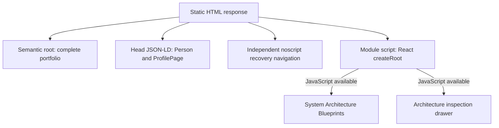

# Architecture & Evaluation Portfolio

**Djessi Jorge — Solutions Architect / Agentic AI Engineer · London, UK**

[Live portfolio](https://portfolio.djessi2.chatgpt.site/) · [LinkedIn](https://www.linkedin.com/in/djessijorge/) · [GitHub profile](https://github.com/djessijorge9-ship-it/)

The public origin is **https://portfolio.djessi2.chatgpt.site/**. Canonical metadata, Open Graph, JSON-LD and the copied executive summary use this same origin. The offline verifier checks their URL parity; public HTTP and browser checks verify deployment availability separately.

## 1. Executive Overview & Architectural Philosophy

This repository contains the portfolio application, its static crawler representation and verification checks. It presents 31 distinct Udacity projects, five featured architecture blueprints and thirteen completed IBM, AWS and Udacity credentials. It does not contain the capstone implementations, training datasets, course handouts or private evaluation logs.

> Selected certification projects. Results reflect educational prototypes and recorded project evaluations.

The engineering philosophy is to make boundaries and evidence inspectable. Grounded answers need retrieval scope and quotation checks. Actions need ownership checks, explicit confirmation and transaction integrity. Evaluation needs stated scenarios, baselines and limitations. Observability needs traces that explain moderation, tool use and outcomes. The portfolio distinguishes applied project capabilities from programme training exposure; training familiarity is not presented as deployed project experience.

Recorded educational evaluations do not establish production throughput, uptime, broad model reliability or commercial outcomes. The handwriting comparison retains its single-seed limitation, OmniTrainer retains its imperfect text/video results, and the SageMaker endpoint was removed after evidence collection.

## 2. System Architecture & Static-Fallback Design

The application has two representations of the same profile and evaluation content:

- **Interactive React SPA:** React 19, TypeScript, Vite, Tailwind CSS and Lucide React provide category filters, keyboard-accessible blueprint tabs, architecture inspection dialogs and a clipboard summary with a selectable-text fallback. The active blueprint is reflected in the `system` query parameter. Inter and JetBrains Mono are bundled locally through Fontsource.
- **Three-layer static fallback:** Layer 1 is a visible semantic portfolio inside `#root`, with complete projects, credentials and capability distinctions. Layer 2 is a head-level JSON-LD graph connecting `ProfilePage` and `Person`, with thirteen official credential destinations. Layer 3 is an independent `noscript` recovery navigation outside the React root, linking to portfolio sections and allowed profile destinations. Native static details remain inspectable without JavaScript.

The existing `createRoot(...).render(...)` mount replaces the static root when React starts. This is a client render over a static fallback, rather than React server hydration. Full content does not depend on a crawler executing the bundle. The independent recovery navigation supplies navigation, while the semantic root supplies the complete content.



| Source | Responsibility |
| --- | --- |
| `src/data.ts` | Profile, five project records, exact evaluations, thirteen credentials, capability matrix and recruiter summary |
| `src/catalogue.ts` | Complete programme-to-project mapping, execution flows, guardrails, recorded results and limits |
| `scripts/sync-catalogue.mjs` | Generate the matching static catalogue, structured data and README inventory during build |
| `src/blueprints.ts` | Five system blueprints: stack, nodes, outcomes and benchmark text |
| `src/App.tsx` and `src/components/` | Interactive presentation, URL state, inspection and clipboard behavior |
| `index.html` | Search/social metadata, semantic static portfolio, JSON-LD and independent no-JavaScript recovery |
| `src/styles.css` | Responsive layout, interaction states and reduced-motion treatment |
| `scripts/verify-portfolio.mjs` | Offline content, source/build parity, repository-gate and privacy assertions |

All public content is served as static files. The portfolio does not call model APIs or require application secrets, a server-side database or a running capstone service.

## 3. Evaluated Capstone Systems Telemetry Table

All five projects are dated **October 2026**. Architecture blueprints preserve each system's boundaries and final outcomes, including guarded escalation, ledger reconciliation and endpoint teardown.

| System and exact stack | Engineering and guardrails | Recorded empirical result |
| --- | --- | --- |
| **UDA-Hub — Autonomous Knowledge Agent**<br>Python, LangGraph, Pydantic, SQLAlchemy, SQLite | Developed a Python/LangGraph supervisor coordinating triage, knowledge retrieval, account operations, resolution, escalation and memory. Used Pydantic, SQLAlchemy and SQLite for structured decisions and persistent state. Implemented tenant-scoped retrieval, exact-quotation checks, ownership checks and confirmed, idempotent cancellation. | Passed 21 offline tests; a final eight-ticket synthetic provider run resolved five cases and escalated three, exercising grounding, memory and guarded actions. |
| **Beaver's Choice — Multi-Agent Sales Workflow**<br>Python, smolagents, Deterministic JSON Tools, SQLite | Built a four-agent Python/smolagents workflow for inventory, quoting and sales in a fictional paper-supply business. Kept pricing, dates, stock validation and ledger authority in deterministic JSON tools. Used atomic SQLite transactions, request keys and content hashes to prevent partial commits and duplicate charges. | Evaluated all 20 supplied scenarios in one model-provider run: four orders fulfilled, 16 declined and zero execution errors, with independent receipt and ledger reconciliation. |
| **OmniTrainer — Multimodal Customer Service Training**<br>FastAPI, Gradio, Gemini API, Pydantic, OpenTelemetry, Arize Phoenix | Connected FastAPI and Gradio to a Gemini-backed training prototype supporting text, image, audio and video. Used typed Pydantic requests and modality-specific moderation before customer-model calls. Instrumented conversations, turns, moderation and feedback with OpenTelemetry/Phoenix. | Passed 45 offline tests and five live setup tests; an observed browser session retained context across two accepted turns and blocked a hostile third turn. Documented imperfect text and video evaluation results. |
| **Synthetic Handwriting — Conditional GAN and Diffusion**<br>PyTorch, Conditional GAN, Diffusion, CNN, MNIST | Adapted Udacity starter architectures in PyTorch and trained conditional GAN and diffusion generators on 60,000 MNIST images. Added reproducible checkpointing, cosine noise scheduling and exponential moving averages. Compared unfiltered samples, FID and synthetic-data utility. | A CNN trained only on 5,000 diffusion-generated digits achieved 95.98% accuracy on 10,000 held-out real digits, versus 81.79% using GAN-generated data in the retained single-seed experiment. |
| **Concrete Strength Prediction — AWS ML Capstone**<br>AWS SageMaker, XGBoost, Ridge Baseline, Python | Compared mean and Ridge baselines with XGBoost using five recipe-grouped folds and a sealed holdout. Selected XGBoost before holdout evaluation. Quantified uncertainty with a paired recipe-group bootstrap. Separately demonstrated the frozen configuration through an actual SageMaker training job and endpoint request; removed the endpoint after evidence collection. | Achieved 5.73 MPa RMSE, 40.82% lower than Ridge, across 180 observations from 86 unseen exact recipes. |

The aggregate benchmark remains **66+** offline and live verification tests, as recorded in the supplied evaluations. Provider scenarios and test-suite counts remain in their original contexts.

<!-- COMPLETE PROJECT INVENTORY START -->
### Complete Udacity project inventory

**31 distinct projects; 26 additions beyond the original five featured systems.** Coverage is all nine completed Udacity Nanodegrees plus the completed microservices course certificate as of 25 October 2026. The AWS capstone proposal and final implementation count as one system; both assessment stages are represented. Lesson exercises, diagnostic reruns, archive revisions and programmes still in progress are excluded.

Programme completion is independently linked to official certificates. Individual retained execution records support the results below; a programme certificate does not replace a missing individual review receipt. Raw course implementations, private datasets and provider logs are excluded from this application repository.

| Completed programme | Distinct projects | Previously featured | Added |
| --- | ---: | ---: | ---: |
| [AWS Machine Learning Engineer Nanodegree](https://www.udacity.com/certificate/e/41150320-caa0-11f1-a7b7-677d26a7417a) | 5 | 1 | 4 |
| [Agentic AI Engineer with LangChain and LangGraph Nanodegree](https://www.udacity.com/certificate/e/7f3f43c0-cd31-11f1-85d2-5797698f73c3) | 3 | 1 | 2 |
| [Agentic AI Nanodegree](https://www.udacity.com/certificate/e/0ca6ac48-cd2e-11f1-81c4-0340813a7e5f) | 4 | 1 | 3 |
| [Generative AI Nanodegree](https://www.udacity.com/certificate/e/823fea76-cd71-11f1-a3e2-1f751a2fc192) | 3 | 1 | 2 |
| [Deep Learning Nanodegree](https://www.udacity.com/certificate/e/38c7402a-cd3e-11f1-a421-27adc65a9265) | 4 | 1 | 3 |
| [Computer Vision Nanodegree](https://www.udacity.com/certificate/e/9c2fe1da-cdb1-11f1-afaa-73d387b1c8b9) | 3 | 0 | 3 |
| [Natural Language Processing Nanodegree](https://www.udacity.com/certificate/e/c1c1a7aa-cdaf-11f1-b6f9-8bb02a043926) | 3 | 0 | 3 |
| [Deep Reinforcement Learning Nanodegree](https://www.udacity.com/certificate/e/2a76d76c-ce2c-11f1-9a30-cb3177fb5d4d) | 3 | 0 | 3 |
| [Data Streaming Nanodegree](https://www.udacity.com/certificate/e/ce6e6422-d041-11f1-bbc9-23cf1ca0d113) | 2 | 0 | 2 |
| [Microservices at Scale using AWS and Kubernetes](https://www.udacity.com/certificate/e/5d8dfadc-d042-11f1-93ef-5f6905dcf04d) | 1 | 0 | 1 |
| **Total** | **31** | **5** | **26** |

#### AWS Machine Learning Engineer Nanodegree

Curriculum record: October 2026 curriculum. [Verify completion](https://www.udacity.com/certificate/e/41150320-caa0-11f1-a7b7-677d26a7417a).

| Project / stack | Execution pipeline | Guardrails / state | Recorded evaluation and limits |
| --- | --- | --- | --- |
| **Predict Bike Sharing Demand with AutoGluon**<br>Python, pandas, AutoGluon, Kaggle | Chronological tabular split and leakage exclusions → Baseline AutoGluon fit → Calendar and cyclic feature engineering → Three-trial tuning and final evaluation | Chronological split Exclude casual and registered leakage columns Keep tuning and final holdout scopes distinct | Kaggle public RMSLE improved from 1.3573 to 0.54289 with features and 0.54124 after HPO. The separate local final holdout RMSE was 79.1729.<br>**Limits:** Public Kaggle leaderboard scores and local holdout RMSE measure different splits and metrics. Most gain came from features; HPO gain was small.<br>**Evidence:** Retained implementation, execution artifacts and evaluation receipts support these results. Programme completion is separately verified by the linked certificate. |
| **Build a ML Workflow For Scones Unlimited On Amazon SageMaker**<br>Python, AWS SageMaker, Lambda, Step Functions, S3, ResNet18 | Prepare bicycle and motorcycle image data → Managed SageMaker image-classifier training → Step Functions serialization and classification → Confidence gate and captured requests → Serving-resource cleanup | Confidence threshold 0.93 abstains through ThresholdConfidenceNotMet Strict dataset/archive integrity checks Separate cloud API receipts from locally executed notebook evidence cells | Final service validation accuracy was 94.79169846%. A high-confidence workflow succeeded; a natural 0.6997604966-confidence case failed at the intended 0.93 gate. Nineteen requests were captured.<br>**Limits:** Service validation denominator was not logged; do not claim a fraction out of 200. Nineteen captured requests include repeated inputs and are neither independent accuracy nor drift evidence. The gate is not calibrated.<br>**Evidence:** Retained implementation, execution artifacts and evaluation receipts support these results. Programme completion is separately verified by the linked certificate. |
| **Image Classification using AWS Sagemaker**<br>Python, PyTorch, ResNet18, AWS SageMaker, Debugger, Profiler | Repair duplicate and undecodable image data → Run two validation-selected HPO trials → Train the selected frozen-backbone classifier → Evaluate and inspect Debugger/Profiler evidence → Private endpoint request and cleanup | Cross-split duplicate and strict-decode repairs Validation-only hyperparameter selection Three fixed training epochs and frozen backbone Native API receipts distinguish cloud execution from local evidence verification | Final test accuracy was 82.3952% on 835 images across 133 classes. Two HPO trials selected hyperparameters; best validation accuracy was 82.8743%.<br>**Limits:** Test metrics were reported for each HPO trial and are not an untouched one-use holdout. Two trials provide limited search. AWS Profiler HTML rendering failed; a clearly labelled reconstruction of actual JSON components was supplied. One endpoint request is not a load benchmark.<br>**Evidence:** Retained implementation, execution artifacts and evaluation receipts support these results. Programme completion is separately verified by the linked certificate. |
| **Operationalizing an AWS ML Project**<br>Python, PyTorch, ResNet50, SageMaker, DistributedDataParallel, EC2, Ray Serve, Lambda | Validation-selected tuning on the 133-breed data → Train with two SageMaker hosts → Demonstrate separate EC2 training → Private Lambda-to-Ray inference and bounded scaling → Capture release evidence and remove resources | Two sequential HPO trials with validation selection Scoped ordinary Lambda permissions and temporary FullAccess removed afterward Lambda concurrency two; endpoint scaling one to two Bounded image inputs, URL checks and 133-probability response validation Actual resource cleanup receipts | Two-host training recorded 80.23952096% test accuracy; the separate EC2 run recorded 80.00%. Lambda returned HTTP 200 with 133 class probabilities.<br>**Limits:** Course prose mentions 33 outputs while the supplied model/data use 133; evidence preserves the actual 133. Initial instance-profile route was denied and first compact EC2 run filled disk; successful retry is distinct. Local evidence-audit PASS is not external review approval.<br>**Evidence:** Retained implementation, execution artifacts and evaluation receipts support these results. Programme completion is separately verified by the linked certificate. |
| **Concrete Strength Prediction — Build Your Own Machine Learning Profile**<br>Python, XGBoost, scikit-learn, AWS SageMaker | Reviewed proposal defines the concrete-strength study → Deduplicate and form disjoint recipe groups → Compare models on five shared grouped folds → Lock model selection and open the sealed holdout → Paired bootstrap, SageMaker demonstration and teardown | Exact deduplication before splitting Recipe groups disjoint between folds and holdout Fold-local Ridge scaling Model-selection lock before holdout No post-holdout tuning | On 180 holdout observations from 86 unseen recipes, XGBoost achieved 5.7329 MPa RMSE versus Ridge 9.6878 MPa; MAE 4.0855 MPa and R² 0.87186. A 1,000-draw paired recipe bootstrap gave an RMSE difference interval of −5.0487 to −2.8767 MPa.<br>**Limits:** Proposal and final are one system. Recipe groups are an imperfect batch proxy; near-identical recipes remain. Bootstrap conditions on fitted models/holdout. This supports screening research, not structural certification. One cloud request is not a latency distribution.<br>**Evidence:** Retained implementation, execution artifacts and evaluation receipts support these results. Programme completion is separately verified by the linked certificate. The reviewed capstone proposal and final submission are represented together as one project. |

#### Agentic AI Engineer with LangChain and LangGraph Nanodegree

Curriculum record: 1.2.37. [Verify completion](https://www.udacity.com/certificate/e/7f3f43c0-cd31-11f1-85d2-5797698f73c3).

| Project / stack | Execution pipeline | Guardrails / state | Recorded evaluation and limits |
| --- | --- | --- | --- |
| **Report-Building Agent**<br>Python, LangChain, LangGraph, Pydantic, OpenAI | Route report intent → Read the supplied simulated documents → Delegate Q&A, summarization or bounded calculation → Validate citations and tool results → Commit canonical history and user-bound session state | Numeric-only bounded AST calculator Citations must reference documents actually retrieved Named-document calculations require current successful reads and an actual calculator result Safe session IDs and user-bound resume Guard validation before checkpoint/memory commit | 10 offline tests passed. Four live turns satisfied five semantic assertions, including a two-invoice total of USD 283,800.<br>**Limits:** Five supplied example documents form a simulated corpus, not a vector database or customer deployment. Four turns are a bounded demonstration. Validation relocation was checked by AST binding; no fresh live run for that relocation is claimed.<br>**Evidence:** Retained implementation, execution artifacts and evaluation receipts support these results. Programme completion is separately verified by the linked certificate. |
| **EcoHome Energy Advisor**<br>Python, LangGraph, LangChain Core, Chroma, SQLAlchemy, SQLite | Retrieve from the versioned energy corpus → Query synthetic usage and solar data → Route tool-supported energy advice → Check grounding, tool coverage and call budgets | Parameterized read-only SQL Deterministic idempotent setup Corpus hash/version compatibility Bounded model/tool calls and sanitized provider errors Weather/tariffs explicitly mocked; no device actuation | The final 12-case live evaluation used 22 provider requests. Eighteen mechanism tests and two evaluator regressions passed; 5/5 designated retrieval probes found the source in the top three. Heuristic accuracy averaged 0.865 and completeness 0.907.<br>**Limits:** Metrics are deterministic evaluator heuristics on 12 fixed cases, not independent human ratings or broad quality. Chroma uses 1024-dimensional token/bigram hash vectors, not learned semantic embeddings. No actual energy savings were measured.<br>**Evidence:** Retained implementation, execution artifacts and evaluation receipts support these results. Programme completion is separately verified by the linked certificate. |
| **UDA-Hub — Autonomous Knowledge Agent**<br>Python, LangGraph, Pydantic, SQLAlchemy, SQLite, OpenAI | Triage synthetic support tickets → Tenant-filtered lexical knowledge retrieval → Check exact quotations and account ownership → Resolve with guarded idempotent state changes or escalate → Persist user-bound issue memory | Tenant/user-bound threads and memory Exact retrieved policy quotation required before resolution Weak evidence escalates Transactional idempotent owned-account cancellation Refund/security/deletion require human support | 21 offline tests passed. The final eight-ticket synthetic provider run resolved five cases and escalated three, using 25 provider requests.<br>**Limits:** Confidence is an operational heuristic, not calibrated probability. Final eight-ticket run supersedes an earlier eight-ticket run with two failures; both receipts persist. Synthetic examples are not a production benchmark.<br>**Evidence:** Retained implementation, execution artifacts and evaluation receipts support these results. Programme completion is separately verified by the linked certificate. |

#### Agentic AI Nanodegree

Curriculum record: 1.3.72. [Verify completion](https://www.udacity.com/certificate/e/0ca6ac48-cd2e-11f1-81c4-0340813a7e5f).

| Project / stack | Execution pipeline | Guardrails / state | Recorded evaluation and limits |
| --- | --- | --- | --- |
| **AgentsVille Trip Planner**<br>Python, Pydantic, OpenAI | Read fictional trip preferences and evidence → Model-directed thought/action/observation loop → Register canonical activities and calculate totals → Validate revisions and invalidate stale approval → Emit the registered approved itinerary | Python owns canonical plan state and computes totals Validate candidate before state replacement Revision invalidates prior approval Final output must match registered approved plan Bounded attempts/revisions/evaluations and zero SDK retries | 31 notebook code cells executed without errors. Eight final evaluations passed; the three-day itinerary cost 110 against a budget of 130, using 19 actual provider calls.<br>**Limits:** Fictional June 2025 itinerary is an educational run. A narrative afternoon-thunderstorm statement exceeded daily-only weather evidence and remains disclosed. Eight evaluations are not general travel reliability.<br>**Evidence:** Retained implementation, execution artifacts and evaluation receipts support these results. Programme completion is separately verified by the linked certificate. |
| **AI-Powered Agentic Workflow**<br>Python, OpenAI, pandas, RAG, Structured JSON | Read source requirements → Generate and critique user stories → Form reviewed feature groups → Build dependency-linked engineering tasks → Validate schema, traceability and graph consistency | Typed record and dependency graph validation Machine checks plus genuine critic reviews Contradictory source references rejected Derived traceability explicitly labelled and provenance logged Provider-call/token/time bounds and untouched raw outputs retained | 118 injected-client offline tests passed. Recorded model outputs contain 26 user stories, 22 feature groups and 22 engineering tasks mapped to 22 source requirement IDs; seven separate agent demonstrations are retained.<br>**Limits:** Final output concatenates genuine original runs and a dependency-only continuation; it is not a fresh complete workflow. Complete references/critic approval do not prove substantive requirement fulfillment. Supplied classroom specification is not redistributable by default.<br>**Evidence:** Retained implementation, execution artifacts and evaluation receipts support these results. Programme completion is separately verified by the linked certificate. |
| **UdaPlay**<br>Python, Chroma, Pydantic, OpenAI, Tavily | Reopen the compatible persistent game collection → Retrieve semantic game evidence → Evaluate evidence and conditionally search the web → Produce cited structured answers with session context | Citations constrained to actual gathered evidence Index compatibility metadata Bounded chat/embedding/search operations No fabricated external search or cross-session learning | 22 notebook code cells executed. Four session questions used local evidence for three answers and one genuine web search; receipts record eight chat requests, seven embedding requests and one search request.<br>**Limits:** Small historical corpus and four questions do not establish broad retrieval quality. Uses provided state-machine abstractions, not LangGraph. Broad Mario wording and imperfect model relevance judgement remain limitations.<br>**Evidence:** Retained implementation, execution artifacts and evaluation receipts support these results. Programme completion is separately verified by the linked certificate. |
| **Beaver’s Choice Paper Company**<br>Python, smolagents, SQLite | Route inventory, quoting and sales across four agents → Apply deterministic stock, price and date authority → Deduplicate requests and transact atomically → Reconcile receipts against the independent ledger | Atomic stock/cash mutations Request keys and content hashes enforce idempotency Independent receipt ledger reconciles canonical state Stock-conserving fictional variants disclosed | All 20 supplied scenarios were evaluated: four fulfilled, 16 declined and zero execution errors. Four orders changed cash state.<br>**Limits:** Sample requests are synthetic educational examples. Sixteen declines are explicit outcomes, not failed or silently successful sales. Fictional variant extension is disclosed.<br>**Evidence:** Retained implementation, execution artifacts and evaluation receipts support these results. Programme completion is separately verified by the linked certificate. |

#### Generative AI Nanodegree

Curriculum record: 3.2.50. [Verify completion](https://www.udacity.com/certificate/e/823fea76-cd71-11f1-a3e2-1f751a2fc192).

| Project / stack | Execution pipeline | Guardrails / state | Recorded evaluation and limits |
| --- | --- | --- | --- |
| **Teaching an LLM to Count**<br>Python, PyTorch, Unsloth, TRL, PEFT, vLLM, Qwen2.5-3B-Instruct | Prepare 401 seeded counting examples → Load a four-bit model and rank-64 LoRA → Apply GRPO with five count/format rewards → Retain the diagnostic and 80-step training log → Check adversarial reward behavior | Seeded reproducible 401-example data Reward assertions plus adversarial checks Separate reward/training observations from held-out generalization Saved adapter scope/export limits disclosed | 24 code cells executed without errors; 19 adversarial checks passed. Across the first and last ten main-training batches, mean correctness reward increased from 0.7625 to 1.56875 and total reward from 2.2291 to 5.1013.<br>**Limits:** Training-batch accuracy is not held-out performance. Diagnostic and main phase are not independent trials. One corrected count example and a factual Paris check are narrow spot checks. Large adapter weights remained on the VM and are not in the lightweight ZIP.<br>**Evidence:** Retained implementation, execution artifacts and evaluation receipts support these results. Programme completion is separately verified by the linked certificate. |
| **NASA Mission Intelligence**<br>Python, Chroma, OpenAI, RAGAS, Streamlit | Index public NASA mission documents with provenance → Apply mission-filtered top-five retrieval → Generate answers with bounded conversation history → Run live judging and lexical overlap evaluation | Source checksums/path/mission/category/offset metadata Mission filter with top-five retrieval Bounded conversation history resets on mission change Offline mechanism checks separated from live answer judging | Twelve documents produced 6,228 chunks. Seventeen engineering checks passed. Across six live questions, mean answer relevancy was 0.9261, faithfulness 0.6528, BLEU 0.0556 and ROUGE 0.3291.<br>**Limits:** Six questions and a probabilistic judge do not prove factual correctness. Prompt change did not materially improve grounding over preserved baseline. One emergency-answer faithfulness score was 0.25; Challenger OCR page-number ambiguity remains.<br>**Evidence:** Retained implementation, execution artifacts and evaluation receipts support these results. Programme completion is separately verified by the linked certificate. |
| **OmniTrainer**<br>Python, FastAPI, Gradio, Gemini, Pydantic, OpenTelemetry, Arize Phoenix | Accept typed text, image, audio and video requests → Run modality-specific moderation before the customer model → Simulate a customer turn and feedback → Instrument moderation, conversation and feedback traces | Moderation before customer-model call Typed request/response contracts Two accepted context turns then hostile turn blocked Trace-based separation of moderation/customer/feedback stages | 45 offline tests and five live setup checks passed. A hostile third turn was blocked after two accepted context turns. Single-repetition provided-judge aggregates were text 83.3%, image 100%, audio 100% and video 75%.<br>**Limits:** Single-repetition provided-judge aggregates are imperfect and not broad robustness guarantees. Shared Gradio object is educational, not production per-user isolation.<br>**Evidence:** Retained implementation, execution artifacts and evaluation receipts support these results. Programme completion is separately verified by the linked certificate. |

#### Deep Learning Nanodegree

Curriculum record: 16.1.11. [Verify completion](https://www.udacity.com/certificate/e/38c7402a-cd3e-11f1-a421-27adc65a9265).

| Project / stack | Execution pipeline | Guardrails / state | Recorded evaluation and limits |
| --- | --- | --- | --- |
| **Diabetes Risk Prediction with PyTorch**<br>Python, PyTorch, scikit-learn | Form deterministic grouped splits → Fit preprocessing only on training data → Compare nine MLP configurations → Select the model and threshold on validation → Evaluate the fixed classifier on the holdout | Grouped splits and train-only preprocessing Validation-only model/threshold selection Explicit precision/recall tradeoff reporting Educational health model scope | On the retained holdout, recall increased from 0.8058 to 0.9350 and false negatives fell from 971 to 325. Selected-model precision was 0.6411, specificity 0.4766 and AUC 0.8232; false positives rose from 1,619 to 2,617.<br>**Limits:** Held-out precision 0.6411 misses the validation precision floor 0.65. Recall gain is mainly threshold tradeoff, with little AUC gain. Balanced deidentified self-report dataset is not a clinical prevalence sample; no clinical-device validation.<br>**Evidence:** Retained implementation, execution artifacts and evaluation receipts support these results. Programme completion is separately verified by the linked certificate. |
| **Landmark Classification and Tagging**<br>Python, PyTorch, ResNet18, TorchScript, ipywidgets | Create a stratified development split → Train randomly initialized and frozen-backbone models → Select checkpoints by validation loss → Evaluate on the sealed test set → Export TorchScript and demonstrate image upload | Reproducible stratified train/validation split Training-only normalization Validation-loss checkpoints and declared improvement rule Sealed test evaluation Interrupted/resumed training history disclosed | Across 1,250 test images and 50 classes, the randomly initialized model classified 768 correctly (61.44%); transfer learning classified 946 correctly (75.68%). Retained runs trained for 75 and 30 epochs respectively.<br>**Limits:** The scratch model uses a ResNet18 architecture with random weights, not pretrained features. Intermediate recovery restarted the optimizer and later resumed full state; do not claim bitwise equivalence to uninterrupted training.<br>**Evidence:** Retained implementation, execution artifacts and evaluation receipts support these results. Programme completion is separately verified by the linked certificate. |
| **Transformer-Based Semantic Retrieval**<br>Python, SentenceTransformers, MiniLM, BM25, Gensim, scikit-learn, Streamlit | Prepare the shared reduced BEIR/NQ corpus → Tune BM25 and Word2Vec on development queries → Retrieve with BM25, Word2Vec and MiniLM → Compare all methods on the same held-out queries → Demonstrate a separate synthetic-corpus app | Development-only tuning Same corpus for all retrieval methods Held-out query set Model/dataset provenance recorded External generative answers disabled | 20 official tests passed. On 160 held-out queries against 435 documents, Recall@5 was 0.8375 for BM25, 0.628125 for Word2Vec and 0.975 for MiniLM; MRR@20 was 0.79104, 0.535722 and 0.952356 respectively.<br>**Limits:** Positives were included by construction in the reduced corpus, making results optimistic relative to the full benchmark. This evaluates retrieval, not fine-tuned generative question-answering. Streamlit uses a separate synthetic TechFlow corpus.<br>**Evidence:** Retained implementation, execution artifacts and evaluation receipts support these results. Programme completion is separately verified by the linked certificate. |
| **Synthetic Handwriting — Conditional Handwriting Generation**<br>Python, PyTorch, Conditional GAN, Diffusion, MNIST | Train conditional GAN and diffusion models on MNIST → Generate balanced unfiltered digit samples → Compare FID on 2,000 samples per model → Train downstream CNNs on 5,000 generated digits → Evaluate once on 10,000 held-out real digits | No external generative weights Balanced unfiltered generated samples Full DDPM posterior and EMA One real-test evaluation for each synthetic-trained classifier Checkpoints and original evaluation artifacts retained | Synthetic-only CNN training achieved 95.98% real-digit accuracy with diffusion versus 81.79% with GAN data. FID was 13.5639 versus 89.6681 on 2,000 samples per model; both generators trained on all 60,000 MNIST images.<br>**Limits:** Single-seed bounded comparison, not production validation. Standard Inception features are imperfect for grayscale digit FID. Classifiers trained on synthetic data are a transfer test, not proof of privacy or universal synthetic-data quality.<br>**Evidence:** Retained implementation, execution artifacts and evaluation receipts support these results. Programme completion is separately verified by the linked certificate. |

#### Computer Vision Nanodegree

Curriculum record: 9.0.2. [Verify completion](https://www.udacity.com/certificate/e/9c2fe1da-cdb1-11f1-afaa-73d387b1c8b9).

| Project / stack | Execution pipeline | Guardrails / state | Recorded evaluation and limits |
| --- | --- | --- | --- |
| **Facial Keypoint Detection**<br>Python, PyTorch, OpenCV, NumPy, Jupyter | Subject-grouped split → 128x128 grayscale preprocessing → Four-block CNN → 68-landmark regression → Face ROI coordinate restoration → Heldout evaluation | 3111 training and 351 validation rows; filename subject-group overlap zero. Official 770-image test evaluated only after validation checkpoint selection. 68-point semantic permutation for horizontal reflections; consistent training/inference preprocessing and non-square ROI coordinate restoration. Checkpoint and source hashes retained. | Forty training epochs; validation selected epoch 35. On 770 official test images: mean landmark error 2.691904306411743 pixels and coordinate RMSE 2.305612564086914 pixels in 128x128 input coordinates; mean interocular-normalized error 0.12694589793682098. Training-meanface baseline error 7.961188793182373 pixels. Eight preprocessing checks passed; 30 executed code cells, zero errors.<br>**Limits:** One seed and educational image split; no demographic fairness or deployment benchmark. Filename grouping covers train/validation separation; the official test is not claimed subject-disjoint. Completed-run notebook replay is not a second fresh training run. Substantial AI assistance disclosed.<br>**Evidence:** Computer Vision Nanodegree · ND891 v9.0.2 · completed programme certificate issued 23 October 2026. Retained implementation and evaluation artifacts support this educational summary. |
| **Image Captioning**<br>Python 3.10.11, PyTorch 2.0.1, torchvision 0.15.2, NLTK, pycocotools, Jupyter, Tesla T4 | COCO image features → Frozen ResNet18 → Trainable projection → LSTM caption training → Greedy decoding → Qualitative gallery | Frozen backbone remains in evaluation mode including batch normalization. All 414113 captions visited once per shuffled same-length-bucket epoch; final short batches retained. Cached/direct feature projection agreement asserted within 1e-5. Continuation checks four source hashes and retains optimizer/scaler state; gradient clipping 5. Single-image sampler emits integer vocabulary IDs and stops at end token or 20 tokens. | Three full epochs over 82783 COCO train2014 images and 414113 captions, totaling 1242339 caption visits. Mean token TRAINING losses: 2.730586839050042, 2.2139843704929953, 2.084513885755988. Training perplexities: 15.341887597447245, 9.152109237601945, 8.040681841534054. Cached-feature maximum error 0.000005811452865600586. Sixteen-image qualitative test gallery; no numeric heldout caption-quality metric.<br>**Limits:** Loss/perplexity are training metrics. No BLEU, CIDEr, heldout accuracy or broad quality benchmark. Gallery includes serious object/action hallucinations and incomplete captions. Run resumed after epoch 1 step 500; no bitwise RNG-identical replay claim. Fixed examples were selected after gallery inspection and inference rerun with unchanged weights. Substantial AI assistance disclosed.<br>**Evidence:** Computer Vision Nanodegree · ND891 v9.0.2 · completed programme certificate issued 23 October 2026. Retained implementation and evaluation artifacts support this educational summary. |
| **Landmark Detection & Tracking (SLAM)**<br>Python 3.12, NumPy, pandas, matplotlib, seaborn, Jupyter | Synthetic robot observations → Information constraints → Pose anchoring → Dense linear solve → Independent reference → Ground-truth comparison | Truth withheld from solver and used only afterward for comparison. Independent rectangular weighted least-squares reference. Unobservable graphs, invalid noise denominators, record counts, landmark indices, nonfinite motions, N and world size rejected. Sensor range/noise boundaries tested; source-bound receipts and unchanged supplied fixtures retained. | 33/33 validation checks; 12 additional random graphs. One synthetic run, seed 89103, 20 poses, 5 landmarks in a 100x100 world, motion/measurement noise amplitudes 2: final-pose error 1.0924966315785074 and mean landmark error 0.5498146921892617 WORLD UNITS. Three notebooks, 28 executed code cells, zero errors.<br>**Limits:** One synthetic run; no image feature extraction, real-robot validation, real-time bounded-memory SLAM or deployment benchmark. Tutorial 1/noise weights are not calibrated Gaussian covariances. Main solver differs from two supplied printed references; independent reference supports the solver. Repeated-motion routine reproduces defective printouts for diagnosis only; initial 31-pass/2-mismatch evidence retained. Substantial AI assistance disclosed.<br>**Evidence:** Computer Vision Nanodegree · ND891 v9.0.2 · completed programme certificate issued 23 October 2026. Retained implementation and evaluation artifacts support this educational summary. |

#### Natural Language Processing Nanodegree

Curriculum record: 6.0.15. [Verify completion](https://www.udacity.com/certificate/e/c1c1a7aa-cdaf-11f1-b6f9-8bb02a043926).

| Project / stack | Execution pipeline | Guardrails / state | Recorded evaluation and limits |
| --- | --- | --- | --- |
| **Part of Speech Tagging**<br>Python 3.6.3, Pomegranate 0.9.0, HiddenMarkovModel, DiscreteDistribution, Jupyter | Brown corpus split → Training frequency counts → MFC baseline → HMM emissions/transitions → Sequence decoding → Heldout tagging accuracy | All estimates fitted to training only. Supplied assertions and prediction functions unchanged. Independent verification supplements original heldout HMM accuracy assertion above 95.5%. | Supplied 80/20 split: 45872 training sentences, 11468 test sentences; 928458 training tokens and 232734 test tokens. HMM training accuracy 0.975354835652232 and heldout token accuracy 0.9594687497314531; MFC heldout 0.9301434255416055. 168 HMM edges. 23/23 executed code cells, zero errors.<br>**Limits:** Educational corpus/split; no production language-coverage benchmark. Substantial AI assistance disclosed in notebook and README.<br>**Evidence:** Natural Language Processing Nanodegree · ND892 v6.0.15 · completed programme certificate issued 25 October 2026. Retained implementation and evaluation artifacts support this educational summary. |
| **Machine Translation**<br>Python 3.11, TensorFlow 2.14, Keras 2.14, NumPy, scikit-learn, GRU, Jupyter, GPU | Deduplicate aligned pairs → Training-only tokenizer → 80/10/10 split → Five recurrent architectures → Validation-selected checkpoint → Fixed-test re-verification | Deduplicated aligned pairs; published rubric demonstrations reserved in training and labelled sanity checks. Tokenizers and maximum lengths fit on training only; validation selects checkpoint/early stopping. Final prediction receives trained model explicitly; AST/runtime guards reject hidden global lookup. Previously viewed fixed test never passed to fit; re-verification after all fits. Failed 25-epoch training-demo assertion retained; final epoch budget changed using training/validation evidence only. | Latest successful revision: 103339 training, 12917 validation and 12918 fixed-test pairs; 163851 nonpadding test tokens. Final token accuracy 0.9760575156697243; normalized exact sequence accuracy 0.8970428858956495. Four baselines each 8 epochs; final 35 epochs under a 40-epoch budget. All 20 code cells executed, zero errors; seven unchanged supplied test calls passed. Test is previously viewed and re-used, not fresh unopened evidence.<br>**Limits:** Small synthetic-vocabulary educational corpus; not a production translator. Lowercase normalized token IDs remove PAD and most punctuation; exact sequence is not original-text exact match. Known fixed test re-evaluated; no new unseen-test claim. Configurations/epoch budgets differ. Substantial AI assistance disclosed.<br>**Evidence:** Natural Language Processing Nanodegree · ND892 v6.0.15 · completed programme certificate issued 25 October 2026. Retained implementation and evaluation artifacts support this educational summary. |
| **DNN Speech Recognizer**<br>Python, TensorFlow/Keras 2.14, CTC, Conv1D, GRU, Bidirectional GRU, LibriSpeech, Jupyter | Supplied spectrogram features → Six acoustic models → CTC alignment training → Validation loss comparison → Checkpoint reload checks → Qualitative decoding | Supplied feature/data/character/loss/training helpers byte-identical; no weakened assertions. Correct convolution output-length formula preserves CTC alignment. Documented dense-CTC padding correction removes shifted padding 0 and preserves character indices 1..28. All six native .keras/acoustic .h5 artifacts reloaded with matching finite normalized probabilities on one real training clip; Adam clipnorm 5. | Six genuine 20-epoch runs. Final validation CTC 119.21956634521484; best validation CTC 116.72305297851562; final training CTC 74.13668060302734. Supplied duration filter 10 seconds retains 2023 training and 1879 validation utterances; batch 32, floor counts 63/58 steps. 28 executed code cells, zero errors. No WER/CER or independent test accuracy.<br>**Limits:** CTC loss measures alignment fit, not word error rate or usable transcription. More final-model capacity prevents an architecture-only causal comparison. Floored/shuffled helper batches do not guarantee every eligible row appears each epoch. Qualitative train/validation decodes are imperfect. Reload checks demonstrate serialization, not recognition accuracy. Substantial AI assistance disclosed.<br>**Evidence:** Natural Language Processing Nanodegree · ND892 v6.0.15 · completed programme certificate issued 25 October 2026. Retained implementation and evaluation artifacts support this educational summary. |

#### Deep Reinforcement Learning Nanodegree

Curriculum record: 5.0.10. [Verify completion](https://www.udacity.com/certificate/e/2a76d76c-ce2c-11f1-9a30-cb3177fb5d4d).

| Project / stack | Execution pipeline | Guardrails / state | Recorded evaluation and limits |
| --- | --- | --- | --- |
| **Navigation**<br>Python 3.10.11, PyTorch 2.0.1, NumPy 1.24.3, Unity Banana, Double DQN, Jupyter | 37-dimensional observation → Epsilon-greedy action → Uniform replay → Double DQN update → 100-episode training audit → Frozen greedy diagnostic | Unmodified rewards and natural terminal signals; no pretrained policy or fabricated scores. Terminal mask prevents episode-boundary bootstrapping; gradient clipping 10. Full 100 consecutive completed episodes required; qualifying training window wholly within one uninterrupted simulator session. Learner/replay/RNG checkpoints and session provenance retained; five uncheckpointed completed attempts archived after timeout. | Final frozen greedy diagnostic: 100 complete episodes, seed 43, epsilon 0, mean reward 13.97 (population std 5.67530615914243), no learning and unchanged policy file. First training crossing: stored episode 538, mean 13.02. Final 100 training mean 13.66 at stored episode 838. Total physical completed attempts 843. Earlier frozen diagnostic 10.69 retained. Raw means independently recomputed and policy hash checked in this audit.<br>**Limits:** One training seed and reused diagnostic seed; no unseen-seed statistical generalization claim. Earlier 10.69 diagnostic prompted further training. Simulator state cannot be restored bit-identically. Substantial AI assistance disclosed.<br>**Evidence:** Deep Reinforcement Learning Nanodegree · ND893 v5.0.10 · completed programme certificate issued 23 October 2026. Retained implementation and evaluation artifacts support this educational summary. |
| **Continuous Control**<br>Python 3.11, PyTorch 2.2.2, NumPy 1.26.3, Unity Reacher, TD3, Tesla T4, Jupyter | 20-agent observations → Bounded continuous actions → Shared replay → Twin critics/delayed actor → 100-training-episode audit → Saved-weight reload rollout | Actions clipped to [-1,1]; unscaled rewards and supplied simulator/helpers unchanged. Success averages all 20 raw agent returns within each episode, then exactly 100 complete episode means. Natural 1001-step time limit distinguished from failure terminal for value bootstrapping only. Atomic model/optimizer/replay/RNG checkpoints; original 48-episode history verified before continuation; preliminary failed smoke log retained. | 114 complete training episodes; first qualifying 100-episode window is episodes 15-114 with mean 30.164534325770102 (threshold 30). Separate deterministic saved-weight reload: ONE 20-agent episode, seed 113, mean 39.597499114926904. Three software invariant checks passed. Raw 20-agent means and 100-window mean independently recomputed; solved checkpoint hash matches reload evidence.<br>**Limits:** Training spans documented resume after episode 48; simulator random state restarts between chunks. 39.5975 is a one-episode reload result, not 100-episode independent generalization. No multiseed statistical benchmark. Substantial AI assistance disclosed.<br>**Evidence:** Deep Reinforcement Learning Nanodegree · ND893 v5.0.10 · completed programme certificate issued 23 October 2026. Retained implementation and evaluation artifacts support this educational summary. |
| **Collaboration and Competition**<br>Python 3.11, PyTorch 2.2.2 CPU, NumPy 1.26.3, Legacy Unity Tennis, Shared TD3, Jupyter | Two local observations → Shared bounded actor → Shared replay/local twin critics → Frozen policy export → 100 consecutive evaluation episodes → Max-player score audit | Legal action bounds [-1,1], gradient norm cap 1 and terminal masking for both players at joint reset. Reject truncated/partial episodes; full 100 complete consecutive episode scores required, each the maximum of the two raw undiscounted returns. Frozen evaluation disables noise, replay insertion and learning; actor tensors/file hash unchanged. Rollback and 18 archived orphan episodes disclosed; apparent training-lineage crossing is not used as uninterrupted training certification. | Independent uninterrupted frozen-policy evaluation: 100 episodes, seed 107, mean maximum-player score 2.045800030510873 (threshold 0.5), zero truncations, zero actor/critic updates. Policy hash matches. Training has 1817 physical episodes, 1799 retained lineage rows and 18 archived orphan episodes; only 99 new episodes after checkpoint restoration. Nine agent and nine finalizer invariant checks recorded OK. Evaluation arithmetic, terminal/update flags and actor hash independently rechecked.<br>**Limits:** One evaluation seed; no broad generalization or production control claim. Unity train_mode=True supplies accelerated headless simulation while policy learning is disabled. Interrupted training lineage is not an uninterrupted 100-episode certificate. Shared local critics are parameter sharing, not centralized MADDPG. Substantial AI assistance disclosed.<br>**Evidence:** Deep Reinforcement Learning Nanodegree · ND893 v5.0.10 · completed programme certificate issued 23 October 2026. Retained implementation and evaluation artifacts support this educational summary. |

#### Data Streaming Nanodegree

Curriculum record: 4.0.5. [Verify completion](https://www.udacity.com/certificate/e/ce6e6422-d041-11f1-bbc9-23cf1ca0d113).

| Project / stack | Execution pipeline | Guardrails / state | Recorded evaluation and limits |
| --- | --- | --- | --- |
| **Optimizing Public Transportation**<br>Python, Kafka, Avro, Kafka Connect, Faust, KSQL, PostgreSQL | CTA simulator emits arrival, rider and weather events → Registry-backed Avro and JDBC station ingestion → Faust station transformations and KSQL rider aggregation → Replayable transit-status dashboard | Physical station IDs and composite line/station keys prevent metadata collisions. Unique rider-event identities preserve count semantics; weather checks per-record acknowledgements. Metadata replay preserves existing station state; consumers rebuild from earliest offsets. | 10 mocked contract tests passed. Live validation reconciled 36,002 rider events across all 92 expected displayed station IDs; verified 230 stop rows, 111 physical stations and real Avro samples from all 94 expected arrival topics.<br>**Limits:** Simulated transit data in a single-broker teaching environment. Plain JSON station records use discoverable logical schema metadata, without Avro wire enforcement. Counts and topic coverage describe the captured run.<br>**Evidence:** Authenticated curriculum marks the project Complete. Retained final source hashes, exact-count reconciliation, arrival-coverage audit and changing dashboard captures support the recorded evaluation. |
| **Evaluate Human Balance with Spark Streaming**<br>Spark Structured Streaming, Python, Kafka, Redis, STEDI | Decode Redis demographics and Kafka assessment events → Apply explicit schemas and malformed-input filters → Join both streams by normalized customer key → Publish enriched Kafka events to the changing STEDI risk graph | Process all Redis entries while choosing one alias to avoid duplicate decoding. Reject invalid base64, malformed dates, empty keys and non-finite scores. Separate checkpoint roots preserve query identity and fail on missing Kafka offsets. | 5 actual native Spark 2.4.6 transformation tests passed in 42.946 seconds, including a real two-input streaming join. Nine runtime source hashes matched. Final integration captured five enriched events and two changing graph states.<br>**Limits:** The five output events describe one matching demo customer, not population coverage. Join state is unbounded and the Kafka sink is at least once; the five-second trigger is not a latency guarantee.<br>**Evidence:** Authenticated curriculum marks the project Complete. Native test logs, worker registration, source hashes, Kafka output and genuine graph screenshots are retained. |

#### Microservices at Scale using AWS and Kubernetes

Curriculum record: 1.0.25 · course certificate. [Verify completion](https://www.udacity.com/certificate/e/5d8dfadc-d042-11f1-93ef-5f6905dcf04d).

| Project / stack | Execution pipeline | Guardrails / state | Recorded evaluation and limits |
| --- | --- | --- | --- |
| **Operationalizing a Coworking Space Microservice**<br>Flask, PostgreSQL, Docker, AWS CodeBuild, ECR, EKS, CloudWatch | Versioned S3 source upload triggers EventBridge and CodeBuild → Test and release a semantic-versioned image to ECR → Deploy analytics and PostgreSQL services to EKS → Verify reports, readiness and periodic CloudWatch health events → Collect evidence and remove demonstration resources | Run the API as a non-root container with distinct liveness and database-readiness checks. Separate database secrets from ConfigMap settings and verify released image digests. Use resource requests/limits and one health scheduler per pod; record cleanup. | 19 local tests passed. The recorded automatic build succeeded and two application replicas were Ready. In-cluster HTTP checks verified both reports; CloudWatch collection retained 72 health events among 452 application events with zero application-error events in that interval.<br>**Limits:** Bounded educational deployment using starter seed data. The collected interval does not establish uptime or production scale. AWS stack and database volume were deleted after evidence capture.<br>**Evidence:** Completed course certificate and retained CodeBuild/ECR/EKS records, service HTTP verification, CloudWatch collection summary and cleanup receipt. |

<!-- COMPLETE PROJECT INVENTORY END -->

## 4. Verified Credentials Ledger

Thirteen credentials were completed in October 2026: three professional certificates, nine Udacity Nanodegrees and one Udacity course certificate. Each destination is the supplied official verification page.

| Credential | Issuer | Completed | Official verification |
| --- | --- | --- | --- |
| IBM Systems and Solutions Architect Professional Certificate | IBM & SkillUp via Coursera | 11 October 2026 | [Verify Certificate ↗](https://www.coursera.org/account/accomplishments/specialization/QCTS5SIEC9UJ) |
| IBM RAG and Agentic AI Professional Certificate | IBM via Coursera | 16 October 2026 | [Verify Certificate ↗](https://www.coursera.org/account/accomplishments/specialization/EV46HYDJREGC) |
| AWS Generative AI Developer Advanced Professional Certificate | Amazon Web Services via Coursera | 16 October 2026 | [Verify Certificate ↗](https://www.coursera.org/account/accomplishments/specialization/2HU8OE27XZOW) |
| AWS Machine Learning Engineer Nanodegree | Udacity | 18 October 2026 | [Verify Certificate ↗](https://www.udacity.com/certificate/e/41150320-caa0-11f1-a7b7-677d26a7417a) |
| Agentic AI Engineer with LangChain and LangGraph Nanodegree | Udacity | 21 October 2026 | [Verify Certificate ↗](https://www.udacity.com/certificate/e/7f3f43c0-cd31-11f1-85d2-5797698f73c3) |
| Deep Learning Nanodegree | Udacity | 21 October 2026 | [Verify Certificate ↗](https://www.udacity.com/certificate/e/38c7402a-cd3e-11f1-a421-27adc65a9265) |
| Generative AI Nanodegree | Udacity | 21 October 2026 | [Verify Certificate ↗](https://www.udacity.com/certificate/e/823fea76-cd71-11f1-a3e2-1f751a2fc192) |
| Agentic AI Nanodegree | Udacity | 21 October 2026 | [Verify Certificate ↗](https://www.udacity.com/certificate/e/0ca6ac48-cd2e-11f1-81c4-0340813a7e5f) |
| Computer Vision Nanodegree | Udacity | 23 October 2026 | [Verify Certificate ↗](https://www.udacity.com/certificate/e/9c2fe1da-cdb1-11f1-afaa-73d387b1c8b9) |
| Deep Reinforcement Learning Nanodegree | Udacity | 23 October 2026 | [Verify Certificate ↗](https://www.udacity.com/certificate/e/2a76d76c-ce2c-11f1-9a30-cb3177fb5d4d) |
| Natural Language Processing Nanodegree | Udacity | 25 October 2026 | [Verify Certificate ↗](https://www.udacity.com/certificate/e/c1c1a7aa-cdaf-11f1-b6f9-8bb02a043926) |
| Microservices at Scale using AWS and Kubernetes (course certificate) | Udacity | 25 October 2026 | [Verify Certificate ↗](https://www.udacity.com/certificate/e/5d8dfadc-d042-11f1-93ef-5f6905dcf04d) |
| Data Streaming Nanodegree | Udacity | 25 October 2026 | [Verify Certificate ↗](https://www.udacity.com/certificate/e/ce6e6422-d041-11f1-bbc9-23cf1ca0d113) |

The professional-certificate scopes are recorded separately from applied project capabilities: systems and solutions architecture; RAG and agentic AI; advanced AWS generative AI development. Udacity study covers agentic AI engineering, generative AI, deep learning, computer vision, deep reinforcement learning, natural language processing, data streaming, AWS machine learning engineering, and microservices at scale using AWS and Kubernetes. These are training areas, not additional applied-project claims. Udacity's certificates distinguish Nanodegree program completion from course completion: Microservices at Scale using AWS and Kubernetes is a course certificate and is not counted as a Nanodegree.

## 5. Local Development & Verification Commands

Use **Node.js 24 or newer** and npm. The offline verifier uses Node's native TypeScript loading for the content and repository gate; it does not require a separate test framework or make network requests.

```sh
npm ci
npm run dev
```

For a production build and the content/repository assertions:

```sh
npm run build
npm run verify
npm run preview
```

The preview normally serves `http://127.0.0.1:4173/`. In a second terminal, inspect the initial crawler response:

```sh
curl --fail --silent --show-error --user-agent "facebookexternalhit/1.1" http://127.0.0.1:4173/
```

The response must expose five complete projects, thirteen certificate links, capability distinctions and JSON-LD without executing JavaScript. `npm run verify` compares source and built semantic roots, metadata and structured data; checks exact credential destinations and recorded results; exercises repository curation gates; checks static inspections and independent recovery navigation; and scans selected release text for private contact details and high-confidence secret formats. It requires an existing `dist/` build. External-page availability and browser interactions remain separate checks.

### Repository curation and rights

A project repository link requires both a dedicated repository URL under the supplied GitHub owner and an explicit `isRepoCurated: true` attestation. The gate rejects account-profile URLs and suppresses uncurated external project links. The five capstone records currently have `repoUrl: null` and `isRepoCurated: false`; inspection and recorded evaluations remain available while their repositories undergo curation. The portfolio repository itself is not substituted for a capstone repository.

The boolean records a manual review decision; it does not cryptographically verify ownership, licensing or evaluation evidence. Two manual gates must pass before it is set:

1. **Rights, provenance and release hygiene:** review original source authorship, dataset redistribution permissions, dependency notices and course distribution restrictions. Publish only rights-cleared implementation code, authored artifacts and logs, retaining required attribution and terms. Limit dataset evidence to rights-cleared MNIST/UCI Concrete data and Djessi's own synthetic runs and evaluation data; dataset names alone do not establish redistribution permission. Exclude proprietary API keys, workspace tokens, non-public datasets, sensitive logs, instructional starter boilerplate and unfinished comments.
2. **Architecture documentation and reproducible evidence:** the dedicated repository README must follow **System Diagram → Guardrail & State Design → How to Run Offline Tests → Evaluation Telemetry Table**. Check that the diagram matches the implementation, state/action boundaries are explained, offline tests can be reproduced, and the evaluation table states the actual evidence and its limitations.

This flagship repository contains portfolio UI and evaluation metadata only. It does not grant blanket permission to copy or redistribute Udacity starter code, course assets or third-party datasets. Any future redistribution requires its own rights review and compliance with applicable terms; dependency licences and notices continue to apply to their respective components.
